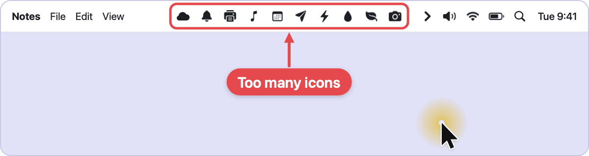
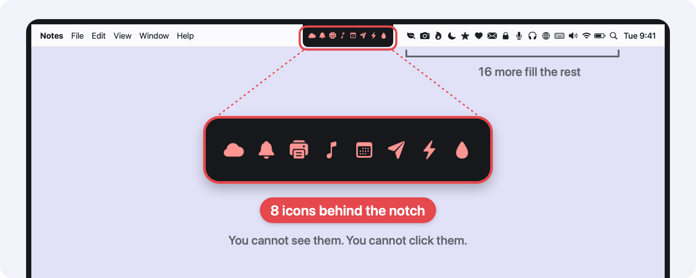
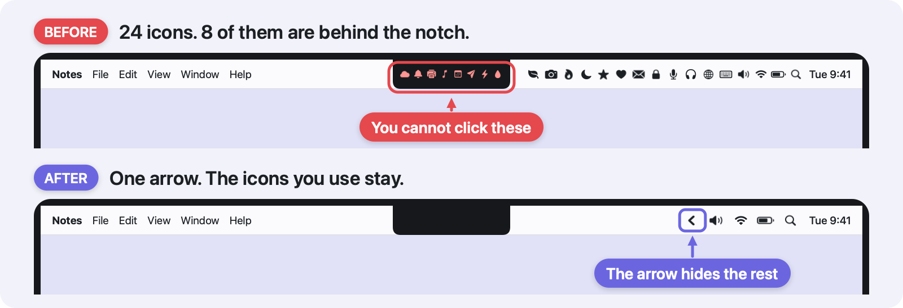
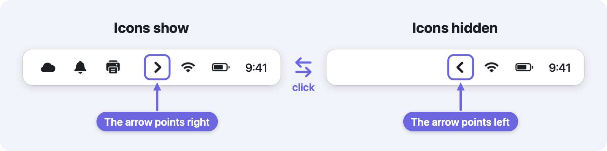
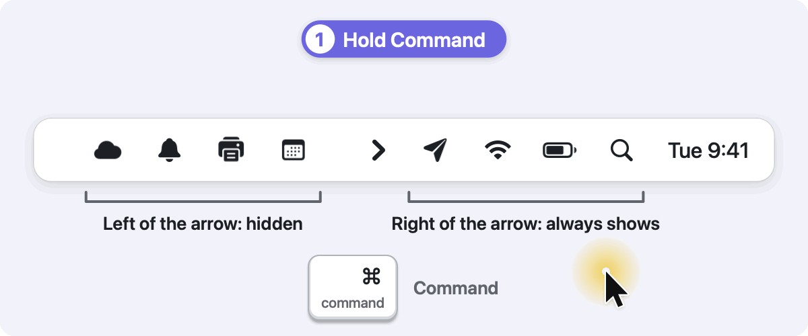
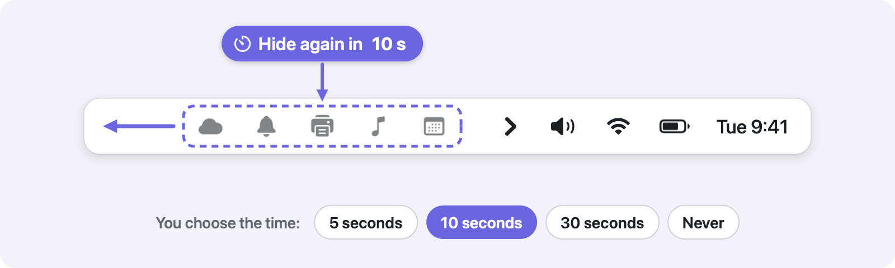
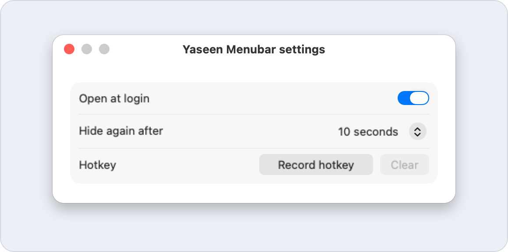
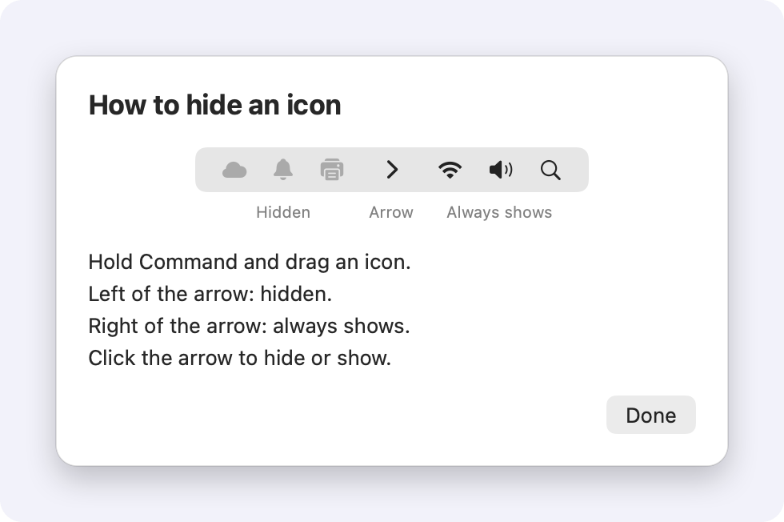

  

<h1 align="center">Yaseen Menubar</h1>

<b>A clean Mac menu bar with one click.</b>

  <code>516 KB</code>&nbsp;
  <code>Zero permissions</code>&nbsp;
  <code>Open source, MIT</code>&nbsp;
  <code>macOS 14 or later</code>

  

  

The menu bar in the pictures is an illustration. The two window pictures are real.

## Your menu bar is full

App after app adds an icon to your menu bar. One icon for the chat app. One for the cloud drive. One for the printer. The bar fills up, and the icons you need are lost between the icons you do not need.

On a MacBook with a notch it gets worse. The notch is the black area at the top middle of the screen. Icons that do not fit go behind it. You cannot see them. You cannot click them.

Our test Mac had 24 icons. 8 of them were behind the notch.

  

## One arrow fixes it

Yaseen Menubar puts one arrow in your menu bar. You choose the icons that stay next to the clock. One click on the arrow hides all the others. One more click shows them.

  

## How it works

### 1. Click the arrow

The icons on the left of the arrow hide. Click again and they come back.

The arrow tells you the state. It points left while icons are hidden. It points right while they show. It is heavy, so you find it fast.

  

### 2. Drag an icon to choose its side

Hold Command and drag an icon across the arrow.

- **Left of the arrow:** the icon hides with the others.
- **Right of the arrow:** the icon always shows.

That is the only rule. Command-drag is the normal macOS way to move a menu bar icon, so there is nothing new to learn.

  

### 3. Do nothing

After you show the icons, they hide again after 10 seconds. You do not have to tidy up.

The icons do not go away while you use them. The app waits while your pointer is in the menu bar. An open menu holds the icons for one minute at most. You choose the time in the settings.

  

One more signal: when a new icon lands on the hidden side, a small dot shows on the arrow.

## Small on purpose

The app does one thing. That keeps it small.

| | Yaseen Menubar 0.1.3 | Bartender 6.5.2 |
| - | - | - |
| App size | **516 KB** | 81 MB |
| Preferences file | **190 bytes** | 1.1 MB, with 2,874 old rows |
| macOS permissions | **None** | Accessibility and Screen Recording |

Bartender has many more functions. This app has one. We measured the two apps on the same Mac.

More numbers from that Mac:

- **Hide: 6.69 ms. Show: 1.01 ms.**
- **With the icons hidden: 0.0% processor, 36 MB memory.**
- No Dock icon. No account. No network call.
- 105 automatic tests pass.

The two times are from version 0.1.1. The other numbers are from version 0.1.3.

## Questions

### Is it safe?

- The app needs zero macOS permissions: no Accessibility, no Screen Recording.
- The app makes no network call and needs no account.
- If the app quits, every icon comes back.
- The app is open source under the MIT licence. The source is public and anyone can read it: [`Sources/MenubarKit`](Sources/MenubarKit).

### What about the notch?

The app does not make the menu bar wider. On a laptop screen with a notch, the icons that do not fit stay behind the notch, also when you show all icons. They fit on an external display.

What you get: the icons on the right of the arrow stay in view. Keep that group small. With too many icons on the right, the arrow itself can go behind the notch.

### Can an icon never show?

Not with this app. It has two sides only: hidden, and always shows. For an icon that must never show, use System Settings > Menu Bar > "Allow in the Menu Bar".

### macOS says it cannot open the app

The download has no Apple notarization. Go to System Settings > Privacy & Security and click "Open Anyway". You do this one time.

### Where are the settings?

Right-click the arrow. The menu has three rows: "Settings…", "How to hide an icon", and "Quit Yaseen Menubar". The settings window has three settings, no more.

  

The full settings window. In this picture, "Open at login" is off.

### Does it start at login?

Yes. At the first start, the app sets itself to open at login. The switch "Open at login" turns that off.

### Is there a hotkey?

It is optional. There is none until you record one. Click "Record hotkey" in the settings and press the keys. The hotkey does the same as a click on the arrow.

## Get it

1. Quit Bartender, or any other menu bar manager. Do not run two of them together.
2. Download the DMG from the [latest release](https://github.com/yaseenarshad/yaseen-menubar-app/releases/latest).
3. Open the DMG. Drag Yaseen Menubar to Applications.
4. Open the app. If macOS refuses, see ["macOS says it cannot open the app"](#macos-says-it-cannot-open-the-app).
5. The arrow comes in the menu bar. A window shows the one rule.

  

  

The app needs macOS 14 or later on an Apple Silicon Mac.

## Status and limits

This is an early version: 0.1.3.

- **Built for:** macOS 14 or later on Apple Silicon.
- **Tested on:** one Mac, with macOS 26.
- **Checked on that Mac:** hide and show, the drag, the right-click menu, and the settings window.
- **Not checked yet on a real Mac:** the hotkey, open at login after a restart, and the dot.

Limits:

- **The notch:** on a laptop screen with a notch, the icons that do not fit stay behind the notch, also when all icons show. See ["What about the notch?"](#what-about-the-notch).
- **The dot:** it is an estimate.

If something does not work on your Mac, [open an issue](https://github.com/yaseenarshad/yaseen-menubar-app/issues).

## For developers

How to build, test, sign, and release the app, and how it works inside: [docs/DEVELOPMENT.md](docs/DEVELOPMENT.md).

## License

MIT. See [LICENSE](LICENSE).
