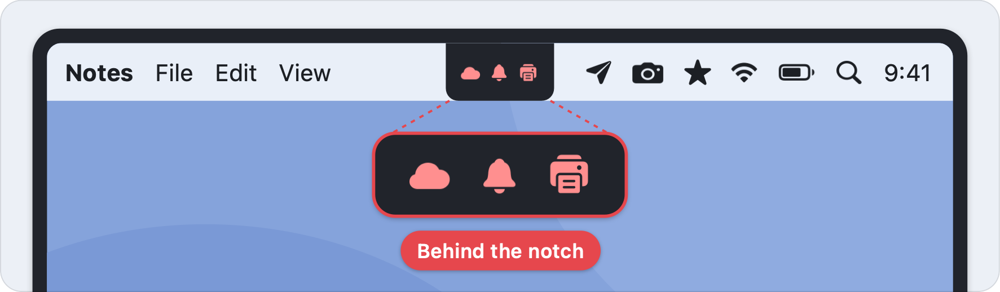
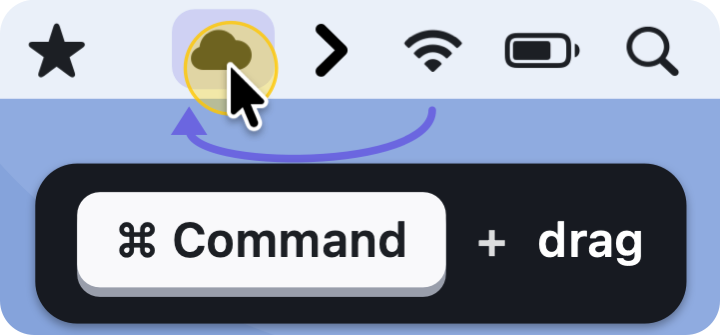
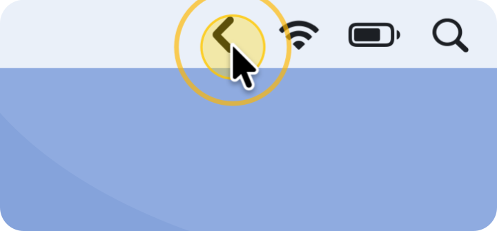
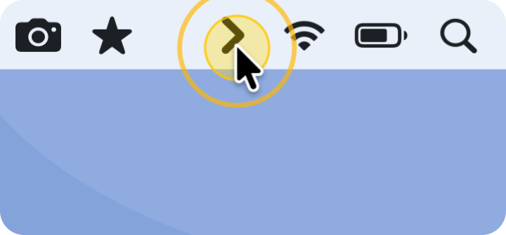
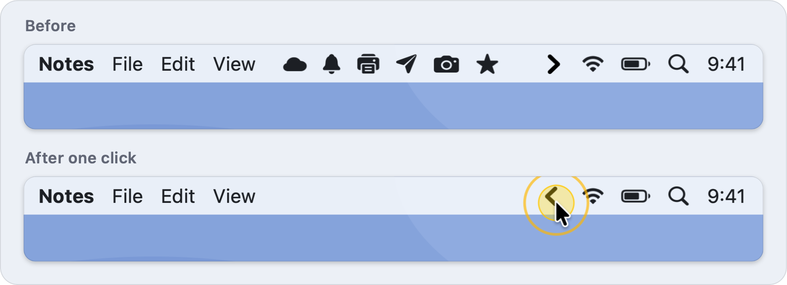
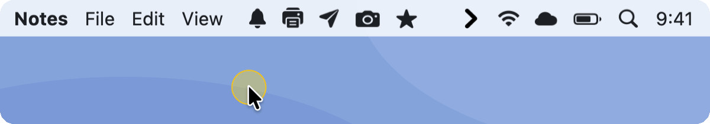
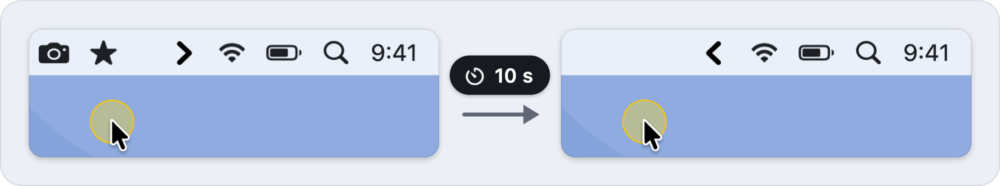
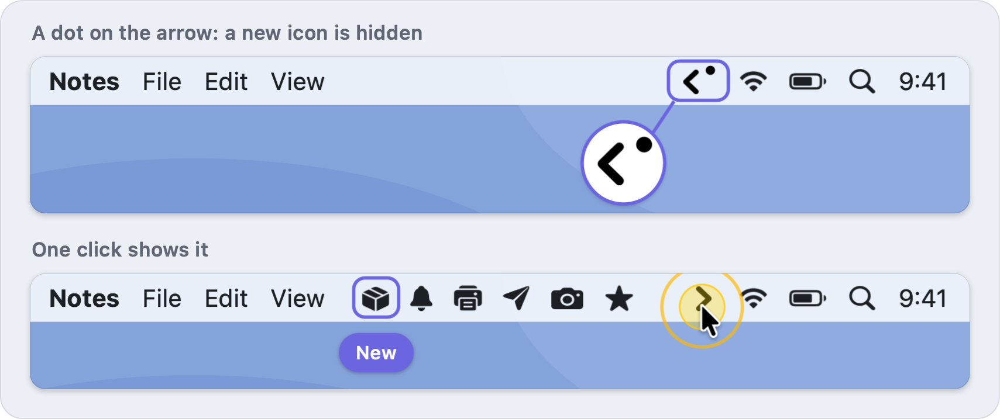

  

  
  
  

  <a href="https://github.com/yaseenarshad/yaseen-menubar-app/releases/latest"><b>Download</b></a> ·
  <a href="#the-answer">How it works</a> ·
  <a href="#the-doubts">Questions</a> ·
  <a href="docs/GUIDE.md">Guide</a>

  <b>Your menu bar shows the few icons that you use. The others are one click away.</b>

  

  <a href="https://github.com/yaseenarshad/yaseen-menubar-app/releases/latest"><b>Download for Mac</b></a> 
  Free · Apple Silicon · macOS 14 or later · under 1 MB

## The problem

My menu bar was so full that the icon of a new app landed behind the notch. I could not see it, and I could not click it. The app I used to hide icons was 81 MB and asked for permission to record my screen, and I used it for one thing. So I built that one thing.

Maybe you know these moments:

- You install an app, and its icon never shows up.
- You know that an icon is there, but the notch covers it.
- Your menu bar has twenty icons, and you use four.
- The tool that must fix this wants to record your screen.

  

## The answer

Yaseen Menubar puts one arrow in your menu bar, and one click on it hides each icon on its left.

<table>
  <tr>
    <td align="center" width="33%"> <b>1. Drag icons left of the arrow</b> Hold Command while you drag.</td>
    <td align="center" width="33%"> <b>2. Click the arrow</b> They hide.</td>
    <td align="center" width="33%"> <b>3. Click again</b> They are back.</td>
  </tr>
</table>

## What it does

### Clear the bar with one click

Click the arrow, and each icon on its left goes away. Click again, and they come back. The arrow points left while icons are hidden, so you always know the state.

**So what:** you see the icons that you use, and the others are one click away.

  

### Choose what stays

Hold Command and drag an icon across the arrow. On the left of the arrow, it hides with the others. On the right of the arrow, it always shows.

**So what:** there is one rule, and no list to manage. Command-drag is the normal Mac way to move a menu bar icon, so you learn nothing new.

  

### It tidies up after you

After you show the icons, they hide again after 10 seconds. The app waits while your pointer is in the menu bar, so no icon goes away below your pointer.

**So what:** you look at an icon and go back to work. You do not click a second time.

  

### Know when a new icon is hidden

macOS puts the icon of a new app at the far left. That is the hidden side. When this happens, a small dot shows on the arrow. The dot is an estimate: the app counts the hidden icons, but it cannot name them.

**So what:** a new app does not put its icon where you never find it. One click shows it.

  

### Small things

- **A hotkey, if you want one.** There is none until you record one. It does the same as a click on the arrow.
- **Open at login.** It is on from the first start. One switch turns it off.
- **Three settings.** That is the full list.
- **No Dock icon.** The app lives in the menu bar only.

  

## The proof

Each number is measured, not estimated. They are from version 0.1.3, on one Mac: an M1 Max with macOS 26 and two displays.

| What | Number |
| -- | -- |
| The app | 516 KB |
| The download | 195 KB |
| The preferences file | 190 bytes |
| The work of the app for one hide | 7.28 ms (one run of the test with the real menu bar) |
| The work of the app for one show | 3.66 ms (the same run) |
| While the app waits | 0.0% processor, 36 MB memory |
| Automatic tests | 105 |

What the app does not need:

- No permission. Not Accessibility, and not Screen Recording.
- No account.
- No payment.
- No internet. The app has no network code.
- No outside code. It is a native Mac app, written in Swift.

Before and after, on the same Mac:

| | Yaseen Menubar 0.1.3 | The menu bar manager I used before |
| -- | -- | -- |
| App size | **516 KB** | 81 MB |
| Preferences file | **190 bytes** | 1.1 MB, with 2,874 old rows |
| macOS permissions | **None** | Accessibility and Screen Recording |

It did many more things. This app does one.

## The doubts

**Is it safe?**
The app asks for no macOS permission. It has no network code. If the app quits, each icon comes back. The code is in this repo, and you can read it.

**Does it cost money?**
No. It is free and open source, with the [MIT licence](LICENSE).

**Why does macOS warn me at the first start?**
Apple has not notarized the app. That needs a paid Apple developer account. Go to System Settings › Privacy & Security and click "Open Anyway". You do this one time.

**Does it work with a notch and with more screens?**
It works with more screens: it is checked on a Mac with three. A screen with a notch has a limit. The app does not make the menu bar wider, so when you show all icons, the ones that do not fit stay behind the notch. The icons on the right of the arrow stay in view. The [guide](docs/GUIDE.md#the-notch) tells more.

**Is it finished?**
No. It is an early version, 0.1.3, tested on one Mac with macOS 26. Checked on that Mac: hide and show, the drag, the right-click menu, and the settings window. Not checked yet on a real Mac: the hotkey, open at login after a restart, and the dot. If something does not work on your Mac, [open an issue](https://github.com/yaseenarshad/yaseen-menubar-app/issues).

## The download

[**Download the newest `.dmg`**](https://github.com/yaseenarshad/yaseen-menubar-app/releases/latest). The app needs a Mac with Apple Silicon and macOS 14 or later.

1. Quit any other menu bar manager. Two of them fight for the same icons.
2. Open the `.dmg`. Drag **Yaseen Menubar** to **Applications**.
3. Open the app. Go to **System Settings › Privacy & Security** and click **Open Anyway**.

The arrow is now in your menu bar, and a small window shows the one rule.

The first three things to try:

1. Hold **Command** and drag an icon to the left of the arrow.
2. Click the arrow. The icon hides. Click again, and it is back.
3. Move the pointer out of the menu bar and count to 10. The icons hide with no click.

## For developers

The app is one Swift package with no outside package. The [developer page](docs/DEVELOPMENT.md) tells how to build, test, sign and release it. The [guide](docs/GUIDE.md) has each detail for users.

The licence is [MIT](LICENSE).
